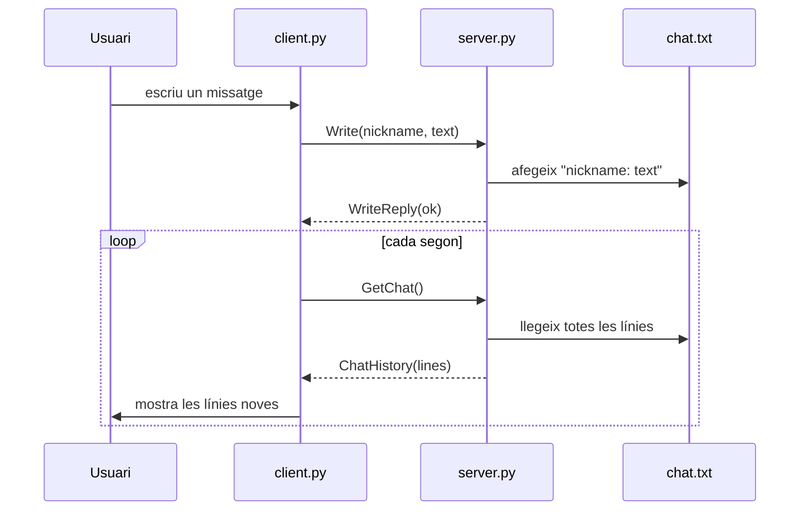

<div align="center">

# Xat amb gRPC

Aplicació de xat client-servidor en Python basada en crides a procediments remots (RPC).


Mini-lab de **Sistemes Distribuïts** · La Salle URL

</div>

---

## Índex

- [Descripció](#descripció)
- [Arquitectura](#arquitectura)
- [Contracte del servei](#contracte-del-servei)
- [Estructura del projecte](#estructura-del-projecte)
- [Configuració](#configuració)
- [Execució](#execució)
- [Regenerar els stubs](#regenerar-els-stubs)

## Descripció

Els clients es connecten a un servidor central amb **gRPC** i els missatges se serialitzen amb **Protocol Buffers**.

- El **servidor** desa tots els missatges a un fitxer local (`chat.txt`) i exposa dos mètodes remots.
- El **client** no guarda res a disc. Fa servir dos fils:
  - el fil principal llegeix el que escriu l'usuari i l'envia amb `Write`;
  - un fil secundari crida `GetChat` cada segon i imprimeix només les línies noves.

## Arquitectura



## Contracte del servei

Definit a [`chat.proto`](chat.proto):

```protobuf
service Chat {
  rpc Write(WriteRequest) returns (WriteReply);
  rpc GetChat(google.protobuf.Empty) returns (ChatHistory);
}
```

| Mètode | Petició | Resposta | Funció |
|---|---|---|---|
| `Write` | `WriteRequest { nickname, text }` | `WriteReply { ok }` | Afegeix `nickname: text` al fitxer |
| `GetChat` | `google.protobuf.Empty` | `ChatHistory { lines[] }` | Retorna tot l'historial |

## Estructura del projecte

```
.
├── chat.proto          # Definició dels missatges i del servei Chat
├── chat_pb2.py         # Generat: classes dels missatges
├── chat_pb2_grpc.py    # Generat: ChatStub, ChatServicer i registre del servei
├── server.py           # Servidor: implementa Write i GetChat sobre chat.txt
├── client.py           # Client: envia missatges i consulta el xat cada segon
└── requirements.txt    # Dependències
```

## Configuració

Requisits: **Python 3.14** (versió provada).

```bash
python -m venv .venv

# Windows
.venv\Scripts\activate
# Linux / macOS
source .venv/bin/activate

pip install -r requirements.txt
```

## Execució

**1. Servidor** (escolta al port `50051`):

```bash
python server.py
```

**2. Clients**, un per terminal i usuari:

```bash
python client.py <chatServerIP> <nickname>
```

Exemple amb dos usuaris a la mateixa màquina:

```bash
python client.py localhost Zipi
python client.py localhost Zape
```

> [!TIP]
> Per sortir del client: `Ctrl+C` o `Ctrl+D`. Per aturar el servidor: `Ctrl+C`.

## Regenerar els stubs

Només cal si es modifica `chat.proto`:

```bash
python -m grpc_tools.protoc -I. --python_out=. --grpc_python_out=. chat.proto
```
